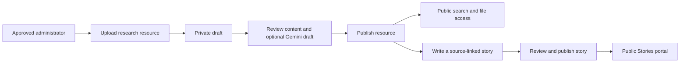

<div align="center">

# Dhruv Atlas

### Polar research, easier to discover. Polar science, easier to understand.

**A knowledge repository and outreach portal connecting published research, reviewed summaries, and accessible science stories.**


Built by **g-SAP** for **Smart India Hackathon 2026**.

[Features](#-the-problem--our-solution) · [Tech Stack](#-tech-stack) · [First Push](#-initial-github-push-local-to-github) · [Local Setup](#-local-installation--setup-for-evaluators) · [Roadmap](#-roadmap--future-scope)

</div>

> **Project status:** Dhruv Atlas currently runs on localhost. There is no public deployment URL or configured CI build badge documented here. Local execution still requires a connected Supabase project; Gemini is optional.

## **SIH Hackathon Context**

| Field | Details |
| :--- | :--- |
| **Problem Statement ID** | **TO COMPLETE:** Insert the official SIH problem statement ID. |
| **Problem Statement Title** | Integrated Polar Science Outreach, Knowledge Repository and Media Dissemination Portal |
| **Theme** | **TO CONFIRM:** Copy the exact theme from the official SIH listing. |
| **Team Name** | **g-SAP** |
| **Solution Name** | **Dhruv Atlas** |
| **Category** | Software / web application |
| **Current Stage** | Functional local prototype with connected database and storage |

**Repository naming:** The supplied remote is [`rohit07-web/DhurvAtlas`](https://github.com/rohit07-web/DhurvAtlas). The commands below preserve that exact spelling. The application name remains **Dhruv Atlas**. If the remote is renamed to `Dhruv-atlas`, update the Git URL accordingly.

## **🌟 The Problem & Our Solution**

### **The problem**

Polar research can be difficult to discover when reports, datasets and supporting media are spread across separate sources. Technical papers also require context that students and general readers may not have. A useful portal must support both access to source material and understandable explanations, with clear editorial responsibility.

### **Our solution**

- **Bring resources together:** Store published reports, datasets and media records in one searchable library.
- **Make research approachable:** Let editors review AI-assisted summaries and create plain-language stories linked to the original resource.
- **Control publication:** Keep drafts private until an approved administrator releases them.
- **Preserve traceability:** Let readers move from a story to its source record and available file.
- **Represent the prototype honestly:** Distinguish uploaded resources from illustrative station readings and demonstration imagery.

### **Core features**

| Feature | What it does |
| :--- | :--- |
| **Searchable knowledge library** | Displays administrator-published resources with search, resource pages and file access. |
| **Secure administration** | Uses Supabase authentication plus explicit administrator membership to protect editing and publishing. |
| **Editorial resource workflow** | Supports upload → draft → review → publish → unpublish. |
| **Gemini-assisted summaries** | Creates private drafts from supplied source material for human review and approval. |
| **Outreach Studio** | Creates, edits, previews, publishes and withdraws source-linked science stories. |

### **How the application works**



Withdrawing a resource removes its public availability for subsequent requests and returns linked stories to draft. Republishing the resource does not automatically republish those drafts. Previously downloaded copies cannot be recalled.

## **🛠️ Tech Stack**

- **Frontend:** Next.js 15 App Router, React 19, TypeScript 5, Tailwind CSS 3 and Lucide icons.
- **Backend:** Next.js Route Handlers and Server Actions for uploads, resource access, AI requests and editorial operations.
- **Database:** Supabase PostgreSQL with Row Level Security (RLS).
- **Authentication:** Supabase Auth with an application-level approved-administrator membership table.
- **File storage:** A private Supabase Storage bucket named `polar_archive`, with access tied to resource publication.
- **AI:** Google Gemini API through `@google/genai`. The model is configurable with `GEMINI_MODEL`.
- **Verification:** TypeScript checks, Next.js production builds, PGlite database-policy tests and HTTP access checks.
- **Development and version control:** Node.js, npm, Git and GitHub.
- **Hosting:** Local Next.js server today. Production hosting and CI/CD remain to be configured.

### **Architecture and access rules**

| Component | Responsibility |
| :--- | :--- |
| Public portal | Browse published resources and stories without an account. |
| Admin portal | Upload, review, edit and publish through an approved account. |
| Server operations | Validate requests and check administrator access. |
| Supabase policies | Restrict database and storage access even when requests bypass the interface. |
| Gemini integration | Generate reviewable drafts; never publish automatically. |

The normal application workflow does **not** require a Supabase service-role key. Keep Gemini credentials server-side; never prefix them with `NEXT_PUBLIC_`.

## **🚀 Initial GitHub Push — Local to GitHub**

These commands push the **existing local codebase** to the exact remote URL provided. They do not create a GitHub repository or deploy the application.

### **1. Check files before the first commit**

Save this README as `README.md` in the project root. Confirm `.gitignore` excludes credentials, dependencies and generated build files. Keep `.env.example` free of real credentials.

Recommended entries:

```gitignore
node_modules/
.next/
out/
build/
.env
.env.*
!.env.example
*.pem
*.tsbuildinfo
```

### **2. Initialize, commit and push**

Run this in **Git Bash on Windows**. The folder below matches the existing local project location.

```bash
cd /c/Users/Rohya/Downloads/DhruvAtlas

git init
git add .

# Review the staged file list. Stop if it includes credentials or private files.
git diff --cached --name-only
git status

git commit -m "initial commit: SIH project codebase"
git branch -M main
git remote add origin https://github.com/rohit07-web/DhurvAtlas.git
git push -u origin main
```

**Before continuing past the review step:** `.env.local`, keys, `node_modules` and `.next` must not be staged. If a local environment file was already tracked, remove it from Git's index with `git rm --cached .env.local`; this keeps the local file. If a real secret was previously committed, rotate it and address its Git history exposure.

### **3. Handle an existing remote or repository history**

If Git reports that `origin` already exists, inspect and update it:

```bash
git remote -v
git remote set-url origin https://github.com/rohit07-web/DhurvAtlas.git
git push -u origin main
```

If GitHub already contains an initial README or license commit, preserve and merge that history rather than force-pushing:

```bash
git fetch origin
git merge origin/main --allow-unrelated-histories

# If Git reports conflicts, resolve them in the affected files first.
git status
git add .
git commit -m "merge: preserve existing GitHub repository history"
git push -u origin main
```

The extra merge commit command is needed only if conflicts left the merge unfinished. If the merge completed automatically, proceed directly to the push. These instructions assume the remote branch is `main`.

Authenticate through GitHub's supported browser/credential-manager flow or a personal access token when requested. Do not put a token in the remote URL. If Git requests author identity, configure your own name and email before committing.

## **💻 Local Installation & Setup for Evaluators**

### **Prerequisites**

- **Node.js 22.x or 24.x** with npm. This setup does not require Python or Docker.
- **Git** and access to this repository.
- **A Supabase project** for PostgreSQL, authentication and storage.
- **A Gemini API key**, only if testing AI-assisted summaries.
- Internet access for the connected services.

### **1. Clone and install**

```bash
git clone https://github.com/rohit07-web/DhurvAtlas.git
cd DhurvAtlas
npm ci
```

`npm ci` uses the committed lockfile for reproducible dependency installation.

### **2. Configure the environment**

Git Bash / macOS / Linux:

```bash
cp .env.example .env.local
```

PowerShell alternative:

```powershell
Copy-Item .env.example .env.local
```

Set these variables in `.env.local`:

```dotenv
# REQUIRED: replace the clearly marked example values with your project settings.
NEXT_PUBLIC_SUPABASE_URL=https://YOUR_PROJECT_REF.supabase.co
NEXT_PUBLIC_SUPABASE_ANON_KEY=YOUR_SUPABASE_PUBLISHABLE_OR_ANON_KEY

# OPTIONAL: leave the key empty to use uploads and manual review without AI.
GEMINI_API_KEY=
GEMINI_MODEL=gemini-3.5-flash-lite
```

The `NEXT_PUBLIC_SUPABASE_ANON_KEY` variable accepts the project's publishable key or legacy anon key. Its public exposure is expected; RLS enforces access. The model shown is the current code default—availability and API quota depend on the configured Google project.

### **3. Initialize a fresh Supabase database**

In the project's **SQL Editor**, run these files in order:

1. `supabase/setup-new-project.sql`
2. `supabase/migrations/20261001_outreach_stories.sql`

The bootstrap sets up the resource schema, admin checks, AI quota controls and private storage. The second migration adds stories and their publication policies.

**For an existing database:** inspect which migrations have already been applied and run only missing migrations. Do not rerun the fresh-project bootstrap or the stories migration over the current configured project.

### **4. Create and approve an administrator**

1. Open **Supabase → Authentication → Users**.
2. Create an email/password user with credentials chosen by the project owner.
3. Confirm that the intended account exists.
4. Run the following SQL after replacing the clearly marked email value:

```sql
-- REQUIRED EDIT: replace ADMIN_EMAIL_TO_REPLACE with the intended user's email.
insert into public.admin_users (user_id)
select id
from auth.users
where lower(email) = lower('ADMIN_EMAIL_TO_REPLACE')
on conflict (user_id) do nothing;
```

Verify that this added the intended user. Creating an authentication account alone does **not** grant administrator privileges. There is no built-in shared admin password.

### **5. Start the application**

```bash
npm run dev
```

Open:

- **Public portal:** http://localhost:3000
- **Admin sign-in:** http://localhost:3000/login
- **Outreach Studio:** http://localhost:3000/admin/outreach

Use the same hostname consistently during a session. Restart the development server after changing environment variables.

### **6. Run verification checks**

```bash
# Database access and publication-policy tests, using local PGlite fixtures.
npm run test:policies

# Production compilation and type validation.
npm run build
```

With the development server running on port 3000, run the separate HTTP access checks:

```bash
node tests/http-access.mjs
```

To serve a production build locally, stop the development server, then run:

```bash
npm start
```

The policy tests cover access rules in a local PostgreSQL-compatible test harness. They do not replace testing against the actual Supabase project. No GitHub Actions build status is claimed.

### **7. Demonstrate the end-to-end workflow**

1. Sign in as an approved administrator.
2. Upload a permitted research file with a title and description.
3. Optionally generate a Gemini draft, review it against the source and save the approved summary.
4. Submit the resource for review, then publish it.
5. Find it in the public library and test its preview/download link.
6. Create an outreach story from that published resource. Add an introduction, byline and body.
7. Save and preview the draft, review it, then publish it to Stories.
8. Test public access in a logged-out browser.
9. Unpublish the story or resource and confirm that new public requests no longer expose the withdrawn content.

### **File and AI boundaries**

- **Upload limit:** 10 MB per file. Permitted formats: PDF, TXT, CSV, PNG, JPEG, WEBP and MP4.
- **Hosting limits:** A future deployment platform may impose a smaller upload/request limit. Validate this before deployment.
- **PDF summarization:** Sends the supplied PDF to Gemini.
- **TXT/CSV summarization:** Uses up to the first 60,000 characters and records that limitation.
- **Other formats:** Uses the supplied description; does not claim to analyze video or images.
- **Privacy:** AI generation sends source material to Google. Use content you are authorized to share with that service.
- **Editorial review:** AI drafts remain private until an administrator approves the relevant content.
- **Story starting text:** Copies an existing approved summary. It does not perform a separate AI story-generation request.
- **Rate control:** The database permits up to five AI generation attempts per administrator per minute.

## **🗺️ Roadmap & Future Scope**

### **Implemented**

- [x] Public library backed by published Supabase resource records.
- [x] Supabase sign-in and explicit administrator approval.
- [x] Protected uploads and database/storage write policies.
- [x] Resource draft, review, publication and withdrawal workflow.
- [x] Resource pages with preview/download links.
- [x] Gemini-generated summary drafts with human approval.
- [x] Outreach story authoring, private previews and public story pages.
- [x] Automatic story withdrawal when the source is unpublished.
- [x] Local database-policy tests and HTTP access checks.

### **Prototype finalization**

- [ ] Replace the illustrative media gallery with published image/video resources.
- [ ] Add richer editable source, institution, publication-date and reuse-rights metadata.
- [ ] Connect region/station exploration to actual published resource counts and results.
- [ ] Complete responsive-layout, keyboard-accessibility and error-state checks.
- [ ] Remove or implement inactive interface controls.
- [ ] Prepare a small, credited demonstration collection.
- [ ] Configure production hosting, environment settings and CI.
- [ ] Repeat end-to-end checks on the deployed application.

### **Future scope**

- [ ] Source-grounded research assistant with citations.
- [ ] Multilingual summaries, glossaries and outreach content.
- [ ] Dedicated AI story drafting with editorial review.
- [ ] Expanded station and expedition management.
- [ ] Usage analytics and publishing notifications.
- [ ] External scientific data integrations, subject to source permissions and availability.

### **What this prototype does not claim**

Station telemetry, expedition displays and the current media gallery contain illustrative content. Dhruv Atlas does not currently provide live scientific monitoring, independent scientific verification, DOI registration or an official institutional partnership. Publication records an administrator's editorial decision; it does not establish scientific peer review or grant reuse rights to a source file.

## **🤝 Contributor Credits**

**Team: g-SAP**

Complete the following entries before the final SIH submission. The repository-owner link comes from the supplied remote; personal names and team roles have not been confirmed.

| Contributor | Role | GitHub |
| :--- | :--- | :--- |
| **TO COMPLETE:** Repository owner's preferred name | Repository owner; project role to confirm | [@rohit07-web](https://github.com/rohit07-web) |
| **TO COMPLETE:** Team member name | Frontend / UX — confirm assignment | **TO COMPLETE:** GitHub profile link |
| **TO COMPLETE:** Team member name | Backend / database — confirm assignment | **TO COMPLETE:** GitHub profile link |
| **TO COMPLETE:** Team member name | Research / content / testing — confirm assignment | **TO COMPLETE:** GitHub profile link |

Add or remove rows to match the actual team. Credit all external research, images and datasets separately with their sources and applicable permissions.

### **Contributing**

Open an issue describing the proposed change, implement it on a branch and submit a pull request with a short explanation and verification steps. Never include credentials, private research files or real user data in issues, commits or screenshots.

### **License**

A project license has not yet been specified in this documentation. Do not assume MIT licensing. If the team chooses MIT, add the appropriate `LICENSE` file with the correct copyright holder and then update the license badge. Research papers, datasets and media retain their respective rights and licenses.

---

<div align="center">

**Dhruv Atlas · g-SAP · Discover the research. Understand the science.**

</div>
